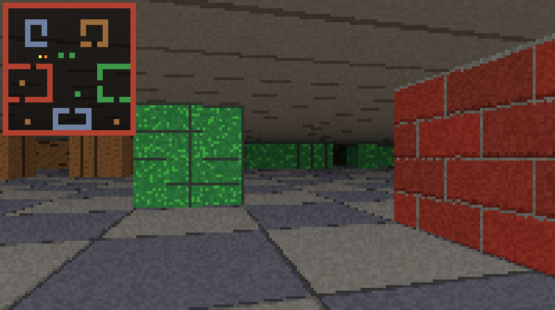

# juniper

A textured 3D raycasting engine written in x86-64 assembly. It runs on Linux,
uses no libc, and renders straight into the terminal with 24-bit colour.



Each terminal cell is drawn as an upper-half-block glyph (`▀`) with separate
foreground and background colours, giving two square pixels per cell. The
framebuffer follows the terminal size (up to 480×270 pixels), so a bigger
window or a smaller font gives a sharper picture.

## Requirements

- Linux on x86-64
- [NASM](https://www.nasm.us/) and `ld` (binutils)
- A terminal with truecolour support

## Building and running

```sh
make        # build bin/juniper
make run    # build and run
make clean  # remove bin/
```

## Controls

| Key                   | Action                |
| --------------------- | --------------------- |
| `W` / `S`, `↑` / `↓`  | Move forward / back   |
| `A` / `D`             | Strafe                |
| `J` / `L`, `←` / `→`  | Turn                  |
| `M`                   | Toggle minimap        |
| `Q`, `Esc`, `Ctrl-C`  | Quit                  |

Terminals that support the kitty keyboard protocol (kitty, foot, WezTerm,
Ghostty, Alacritty, ...) report key releases, so movement is smooth while a
key is held. Other terminals fall back to one step per key event, driven by
key autorepeat.
